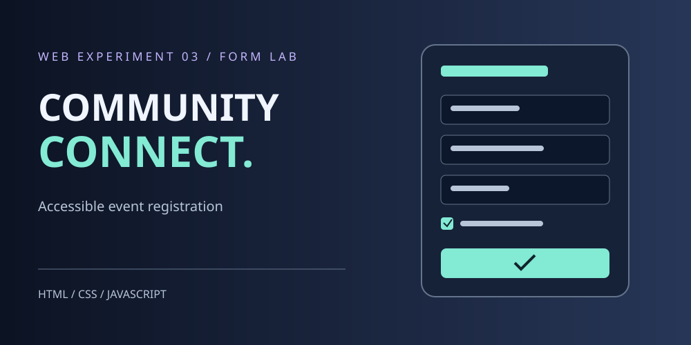

# Community Connect — Event Registration



A responsive community event registration form built for an introductory web-development experiment. It demonstrates semantic forms, CSS Grid and Flexbox, accessible validation, optional preferences, and a local registration preview.

**Status:** Academic project / implemented frontend prototype. No live booking or verified public deployment.

## Features

- Five original sample events: Community Dinner, Yoga Class, Art Workshop, Tech Talk and Volunteer Day.
- Required name, email and event fields; optional phone, preferences and comments.
- Native browser constraints plus JavaScript validation for whitespace, email format, optional phone and allowed event values.
- Inline error messages, keyboard focus, accessible labels and fieldsets.
- Character count, reset and registration preview with no backend.
- Responsive dark interface and disabled form when JavaScript is unavailable.

## Run locally

From the repository root:

```bash
python -m http.server 8000
```

Open http://localhost:8000. No dependencies, account or API key required.

## Structure

- `index.html` — semantic form, event information and preview
- `styles.css` — responsive layout and accessible form styling
- `registration.js` — validation and local form interactions
- `tests/registration.test.js` — validation regression tests
- `assets/cover.svg` — original project concept cover

## Testing

With Node.js 18+:

```bash
node --test tests/registration.test.js
```

Manual browser checks: invalid fields, optional empty phone, checkbox selection, reset, confirmation, keyboard navigation, mobile layout and disabled JavaScript.

## Privacy and limitations

Use fictional data only. The prototype does not transmit or persist form details and does not make a real reservation or subscribe anyone to communications. Event names are illustrative; no dates, locations or capacity are claimed. Production registration would require a backend, server-side validation, consent controls and secure data handling.

## Deployment

Can be hosted on a static host. No live URL is listed until verified.
